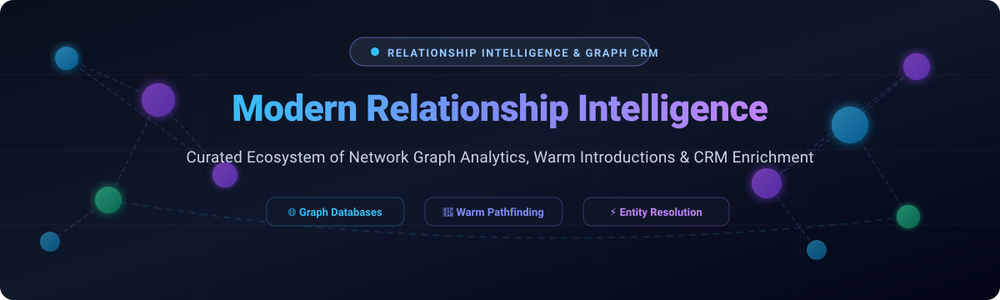

<p align="center">
  
</p>

# 🌐 Awesome Modern Relationship Intelligence [](https://github.com/ishandutta2007/Awesome-Awesome-Awesome)

<p align="center">
  <a href="https://github.com/ishandutta2007/Awesome-Awesome-Awesome"></a><a href="https://discord.gg/jc4xtF58Ve"></a>
  <a href="https://github.com/ishandutta2007/Awesome-Modern-Relationship-Intelligence/stargazers"></a>
  <a href="https://github.com/ishandutta2007/Awesome-Modern-Relationship-Intelligence/network/members"></a>
  <a href="https://github.com/ishandutta2007/Awesome-Modern-Relationship-Intelligence/issues"></a>
  <a href="https://github.com/ishandutta2007/Awesome-Modern-Relationship-Intelligence/blob/main/LICENSE"></a>
  <a href="https://github.com/ishandutta2007"></a>
</p>

---

## 📌 Executive Summary & Ecosystem Overview

> **A curated, battle-tested index of modern relationship intelligence platforms, graph databases, network analytics engines, and CRM data enrichment frameworks.**

Welcome to the definitive repository tracking both enterprise **SaaS platforms** and high-performance **open-source systems** engineered for **Modern Relationship Intelligence**. These solutions automatically extract unstructured interaction data (emails, calendar invites, virtual meetings, social connections), reconstruct organizational social graphs, deduplicate contacts via machine learning entity resolution, and surface warm introduction pathways for B2B sales teams, venture capital investors, executive search firms, and revenue operations professionals.

### 🔍 Key Keyword Index (SEO)
`Relationship Intelligence` • `Revenue Intelligence` • `Network Graph Analytics` • `Graph Databases` • `B2B Warm Introductions` • `CRM Data Enrichment` • `Entity Resolution` • `Graph Neural Networks` • `Executive Network Mapping` • `Deal Sourcing CRM`

---

## 📑 Table of Contents
- [📊 Sector Overview & Market Dynamics](#-sector-overview--market-dynamics)
- [🏢 SaaS & Hosted Enterprise Platforms](#-saas--hosted-enterprise-platforms)
- [💻 Open-Source GitHub Projects](#-open-source-github-projects)
  - [🗄️ Graph Databases & Query Engines](#️-graph-databases--query-engines)
  - [📈 Network Analysis & Visualization](#-network-analysis--visualization)
  - [👥 Open-Source CRM & Contact Hubs](#-open-source-crm--contact-hubs)
  - [🧩 Entity Resolution & Data Enrichment](#-entity-resolution--data-enrichment)
  - [🧠 Graph Machine Learning](#-graph-machine-learning)
- [🏗️ Architectural Blueprints for Custom Stacks](#️-architectural-blueprints-for-custom-stacks)
- [🤝 How to Contribute](#-how-to-contribute)
- [💖 Support & Sponsorship](#-support--sponsorship)
- [📈 Star History](#-star-history)
- [⚖️ Disclaimer & Compliance](#️-disclaimer--compliance)

---

## 📊 Sector Overview & Market Dynamics

The global sales and revenue intelligence market is estimated at approximately **$5.37 billion in 2026** (with the broader personal & relationship CRM market reaching **$16.5 billion**), expanding at an accelerating double-digit CAGR. While historically **moderately fragmented** across vertical point solutions in VC dealflow management, legal partner networks, and call recording transcription, the sector is experiencing rapid **consolidation** into unified revenue orchestration platforms as enterprise CRM market leaders embed native graph analytics and multi-agent AI relationship intelligence.

---

## 🏢 SaaS & Hosted Enterprise Platforms

The table below compiles category-defining commercial platforms, sorted in descending order by parent company scale (valuation and revenue), with exact entry tier pricing and documented trial evaluation limits.

| Platform | 🏢 Scale (Valuation / Revenue) | 💳 Pricing (Starting Tier) | 🎁 Free Tier / Trial Limit | 📝 Description |
| :--- | :--- | :--- | :--- | :--- |
| **[Salesforce Relate](https://www.salesforce.com/)** | ~$280B Market Cap / $38B Revenue | $25/user/month (Starter Suite, billed annually) | 30-day free trial (Full CRM features, 2-user limit on Free CRM edition) | Comprehensive CRM relationship intelligence suite mapping executive connections, tracking activity streams, and surfacing warm paths. |
| **[ZoomInfo Chorus](https://www.zoominfo.com/)** | ~$4.5B Market Cap / $1.2B Revenue | ~$15,000/year (Base platform contract entry, ~$100–$150/user/month) | 14-day sales-assisted free trial (up to 3 recorded meetings & sample call transcript analytics) | Conversation intelligence and relationship mapping suite capturing stakeholder sentiment and buying committee dynamics. |
| **[Clari](https://www.clari.com/)** | ~$3.1B Valuation / ~$150M ARR | $100/user/month (Core platform, billed annually) | 14-day guided sandbox trial (requires sales qualification, pipeline inspection demo limits) | Revenue operations and relationship mapping platform surfacing deal risk, connection paths, and pipeline analytics. |
| **[People.ai](https://people.ai/)** | ~$1.1B Valuation / ~$50M ARR | $50/user/month (Enterprise Activity Capture tier, billed annually) | 14-day sales-led pilot trial (limited to 5 connected executive mailboxes) | Enterprise revenue intelligence platform capturing engagement graphs, buying group mapping, and automated CRM record enrichment. |
| **[DealCloud](https://www.dealcloud.com/)** | ~$2.8B Parent Market Cap (Intapp) / ~$450M Revenue | ~$250/user/month (Billed annually; typical minimum annual contract ~$30,000) | No perpetual free plan; 14-day custom guided pilot on qualified deal pipeline | Financial services and private capital relationship intelligence platform tracking co-investor networks and intermediary connections. |
| **[Affinity](https://www.affinity.co/)** | ~$600M Valuation / ~$40M ARR | $165/user/month (Essential tier, billed annually at $1,980/user/yr) | 14-day trial available via sales consultation (sandbox access for up to 3 team members) | Relationship intelligence CRM designed for VC, PE, and investment banking with automatic communication capture and graph mapping. |
| **[Introhive](https://introhive.com/)** | ~$300M Valuation / ~$35M ARR | ~$150/user/month (Billed annually; base enterprise deployment starts at $25,000/year) | No perpetual free tier; 14-day sales-provisioned pilot evaluation for qualified professional services teams | AI-driven relationship intelligence platform mapping communication graphs and automating CRM data cleanliness for professional services. |
| **[BoardEx](https://www.boardex.com/)** | ~$150M Parent Revenue (Altrata/Euromoney) | $4,500/seat/year (~$375/month, individual research license) | 7-day limited trial on request (maximum 10 executive profile lookups and network path searches) | Relationship mapping platform indexing global board members, corporate leaders, executive pedigree, and C-suite overlaps. |
| **[RelSci](https://www.relationshipscience.com/)** | ~$100M Acquisition Valuation (Altrata) | $3,000/user/year (~$250/month, minimum contract requirements) | 7-day sales-verified trial (up to 15 pathfinder queries and executive dossier lookups) | Enterprise relationship graph connecting 10M+ decision-makers, tracking warm connection degrees and organizational spheres of influence. |
| **[Nektar.ai](https://nektar.ai/)** | ~$35M Valuation / ~$5M ARR | $39/user/month (Plus data backfill fees, billed annually) | 14-day free trial (captures up to 90 days of communication history across 5 users) | Revenue operations and contact intelligence engine uncovering hidden buyer relationships and addressing CRM data gaps. |

---

## 💻 Open-Source GitHub Projects

Explore the most powerful open-source repositories powering self-hosted relationship graphs, privacy-first interaction capture, and identity resolution. Sorted in descending order by GitHub community stars:

### 🗄️ Graph Databases & Query Engines

- **[Elasticsearch](https://github.com/elastic/elasticsearch)** [](https://github.com/elastic/elasticsearch/stargazers)  
  ⚡ Distributed, RESTful search and analytics engine featuring native graph exploration APIs for real-time relationship and connection discovery. *SSPL licensed.*

- **[SurrealDB](https://github.com/surrealdb/surrealdb)** [](https://github.com/surrealdb/surrealdb/stargazers)  
  ⚡ Scalable, multi-model cloud-native database incorporating first-class graph relations and query traversal for building relationship intelligence platforms. *Apache 2.0 licensed.*

- **[Hasura GraphQL Engine](https://github.com/hasura/graphql-engine)** [](https://github.com/hasura/graphql-engine/stargazers)  
  ⚡ Blazing-fast GraphQL engine providing automated relationship traversal and instant unified APIs over disparate contact databases. *Apache 2.0 licensed.*

- **[Dgraph](https://github.com/dgraph-io/dgraph)** [](https://github.com/dgraph-io/dgraph/stargazers)  
  ⚡ Enterprise-grade, distributed GraphQL-native graph database optimized for large-scale enterprise relationship network queries. *Apache 2.0 licensed.*

- **[GunDB](https://github.com/amark/gun)** [](https://github.com/amark/gun/stargazers)  
  ⚡ Decentralized, real-time graph database enabling privacy-preserving, peer-to-peer relationship intelligence networks. *MIT / Apache 2.0 licensed.*

- **[Neo4j](https://github.com/neo4j/neo4j)** [](https://github.com/neo4j/neo4j/stargazers)  
  ⚡ The industry-standard native graph database engine, purpose-built for querying professional connections, multi-hop pathways, and graph analytics. *GPL-3.0 licensed.*

- **[Cayley](https://github.com/cayleygraph/cayley)** [](https://github.com/cayleygraph/cayley/stargazers)  
  ⚡ Open-source graph database written in Go, inspired by Google's Knowledge Graph and Freebase for relationship-heavy applications. *Apache 2.0 licensed.*

- **[ArangoDB](https://github.com/arangodb/arangodb)** [](https://github.com/arangodb/arangodb/stargazers)  
  ⚡ Multi-model database combining native graph, document, and search indexes with AQL for flexible relationship queries and contact records. *Apache 2.0 licensed.*

- **[OpenSearch](https://github.com/opensearch-project/OpenSearch)** [](https://github.com/opensearch-project/OpenSearch/stargazers)  
  ⚡ Community-driven search and analytics suite offering neural search and graph analytics plugins for relationship exploration. *Apache 2.0 licensed.*

- **[PostGraphile](https://github.com/graphile/postgraphile)** [](https://github.com/graphile/postgraphile/stargazers)  
  ⚡ Instant, extensible GraphQL API builder for PostgreSQL databases that compiles complex relational queries into performant SQL queries. *MIT licensed.*

- **[NebulaGraph](https://github.com/vesoft-inc/nebula)** [](https://github.com/vesoft-inc/nebula/stargazers)  
  ⚡ High-throughput distributed graph database designed for handling billions of vertices and edges across large-scale enterprise social graphs. *Apache 2.0 licensed.*

- **[JanusGraph](https://github.com/JanusGraph/janusgraph)** [](https://github.com/JanusGraph/janusgraph/stargazers)  
  ⚡ Scalable graph database optimized for storing and traversing massive graphs distributed across multi-node clusters. *Apache 2.0 licensed.*

- **[OrientDB](https://github.com/orientechnologies/orientdb)** [](https://github.com/orientechnologies/orientdb/stargazers)  
  ⚡ Multi-model graph database combining document-store flexibility with graph relationship traversal. *Apache 2.0 licensed.*

- **[Apache AGE](https://github.com/apache/age)** [](https://github.com/apache/age/stargazers)  
  ⚡ PostgreSQL extension providing openCypher graph database capabilities directly within relational PostgreSQL databases. *Apache 2.0 licensed.*

- **[Memgraph](https://github.com/memgraph/memgraph)** [](https://github.com/memgraph/memgraph/stargazers)  
  ⚡ In-memory graph database built in C++ with Cypher support, engineered for low-latency streaming relationship analytics. *BSL licensed.*

- **[Kùzu](https://github.com/kuzudb/kuzu)** [](https://github.com/kuzudb/kuzu/stargazers)  
  ⚡ Embedded, in-process Cypher graph database management system designed for fast graph algorithms and analytics over relational data. *MIT licensed.*

- **[Apache HugeGraph](https://github.com/apache/hugegraph)** [](https://github.com/apache/hugegraph/stargazers)  
  ⚡ Apache-incubated distributed graph system designed for enterprise network exploration and deep relationship traversal. *Apache 2.0 licensed.*

- **[Apache TinkerPop](https://github.com/apache/tinkerpop)** [](https://github.com/apache/tinkerpop/stargazers)  
  ⚡ Graph computing framework providing the Gremlin traversal language across diverse graph databases and query processors. *Apache 2.0 licensed.*

- **[RedisGraph](https://github.com/RedisGraph/RedisGraph)** [](https://github.com/RedisGraph/RedisGraph/stargazers)  
  ⚡ Graph database module for Redis implementing the openCypher language and linear algebra matrix multiplication for graph queries. *SSPL licensed.*

---

### 📈 Network Analysis & Visualization

- **[Apache Superset](https://github.com/apache/superset)** [](https://github.com/apache/superset/stargazers)  
  📊 Modern enterprise business intelligence platform equipped with network and relationship visualization plugins for graph analytics dashboards. *Apache 2.0 licensed.*

- **[Metabase](https://github.com/metabase/metabase)** [](https://github.com/metabase/metabase/stargazers)  
  📊 Intuitive open-source data visualization and business intelligence tool supporting relational graph exploration and interactive relationship reporting. *AGPL-3.0 licensed.*

- **[NetworkX](https://github.com/networkx/networkx)** [](https://github.com/networkx/networkx/stargazers)  
  📊 Comprehensive Python library for studying the structure and dynamics of complex networks, shortest path discovery, and centrality metrics. *BSD-3-Clause licensed.*

- **[Sigma.js](https://github.com/jacomyal/sigma.js)** [](https://github.com/jacomyal/sigma.js/stargazers)  
  📊 Lightweight WebGL-powered JavaScript library for rendering responsive, large-scale interactive relationship network graphs in the browser. *MIT licensed.*

- **[Cytoscape.js](https://github.com/cytoscape/cytoscape.js)** [](https://github.com/cytoscape/cytoscape.js/stargazers)  
  📊 Graph analysis and visualization library featuring rich layout algorithms, edge bundling, and path highlighting for relationship data. *MIT licensed.*

- **[Gephi](https://github.com/gephi/gephi)** [](https://github.com/gephi/gephi/stargazers)  
  📊 Interactive desktop visualization and exploration platform for all kinds of networks and complex relationship topologies. *GPL-3.0 licensed.*

- **[vis-network](https://github.com/visjs/vis-network)** [](https://github.com/visjs/vis-network/stargazers)  
  📊 Interactive network graph visualization component supporting physics simulations and dynamic node-edge relationship navigation. *Apache 2.0 licensed.*

- **[igraph](https://github.com/igraph/igraph)** [](https://github.com/igraph/igraph/stargazers)  
  📊 High-performance network analysis library offering C, Python, and R interfaces for community detection and relationship graph metrics. *GPL-2.0 licensed.*

- **[Graphology](https://github.com/graphology/graphology)** [](https://github.com/graphology/graphology/stargazers)  
  📊 Robust JavaScript specification and implementation for graph data structures, algorithms, and visualization pipelines. *MIT licensed.*

---

### 👥 Open-Source CRM & Contact Hubs

- **[Twenty](https://github.com/twentyhq/twenty)** [](https://github.com/twentyhq/twenty/stargazers)  
  🤝 Modern open-source CRM alternative to Salesforce with native relationship intelligence features, custom entity graphs, and rich network views. *AGPL-3.0 licensed.*

- **[Odoo](https://github.com/odoo/odoo)** [](https://github.com/odoo/odoo/stargazers)  
  🤝 Comprehensive open-source business suite with relationship management, interaction logging, and multi-organization stakeholder mapping. *LGPL-3.0 licensed.*

- **[Chatwoot](https://github.com/chatwoot/chatwoot)** [](https://github.com/chatwoot/chatwoot/stargazers)  
  🤝 Open-source customer engagement platform unifying omnichannel communication touchpoints to construct continuous relationship history. *AGPL-3.0 licensed.*

- **[Krayin CRM](https://github.com/krayin/laravel-crm)** [](https://github.com/krayin/laravel-crm/stargazers)  
  🤝 Extensible Laravel-powered open-source CRM featuring contact interaction tracking, relationship management, and lead pipeline analytics. *MIT licensed.*

- **[SuiteCRM](https://github.com/salesagility/SuiteCRM)** [](https://github.com/salesagility/SuiteCRM/stargazers)  
  🤝 Enterprise-ready open-source CRM platform providing detailed interaction history, contact network management, and custom relations. *AGPL-3.0 licensed.*

- **[Frappe CRM](https://github.com/frappe/crm)** [](https://github.com/frappe/crm/stargazers)  
  🤝 Modern, reactive open-source CRM built on the Frappe framework with lead tracking, deal pipelines, and stakeholder engagement records. *AGPL-3.0 licensed.*

- **[EspoCRM](https://github.com/espocrm/espocrm)** [](https://github.com/espocrm/espocrm/stargazers)  
  🤝 Lightweight open-source web application for managing relationships between companies, people, and opportunities. *GPL-3.0 licensed.*

---

### 🧩 Entity Resolution & Data Enrichment

- **[Prisma](https://github.com/prisma/prisma)** [](https://github.com/prisma/prisma/stargazers)  
  🧬 Next-generation Node.js and TypeScript ORM offering declarative relational modeling for building custom contact graphs and interaction stores. *Apache 2.0 licensed.*

- **[Dedupe](https://github.com/dedupeio/dedupe)** [](https://github.com/dedupeio/dedupe/stargazers)  
  🧬 Python library using machine learning to perform entity resolution and contact deduplication across messy relationship datasets. *MIT licensed.*

- **[Splink](https://github.com/moj-analytical-services/splink)** [](https://github.com/moj-analytical-services/splink/stargazers)  
  🧬 Fast probabilistic entity resolution and record linkage library at scale using Fellegi-Sunter methodology in DuckDB, Spark, and SQLite. *MIT licensed.*

- **[Zingg](https://github.com/zinggAI/zingg)** [](https://github.com/zinggAI/zingg/stargazers)  
  🧬 Open-source ML-based entity resolution tool to unify customer records and match identity graphs across enterprise data lakes. *AGPL-3.0 licensed.*

---

### 🧠 Graph Machine Learning

- **[PyTorch Geometric](https://github.com/pyg-team/pytorch_geometric)** [](https://github.com/pyg-team/pytorch_geometric/stargazers)  
  🔬 Leading deep learning library for Graph Neural Networks (GNNs), ideal for link prediction, warm-introduction scoring, and relationship graph ML. *MIT licensed.*

- **[Deep Graph Library (DGL)](https://github.com/dmlc/dgl)** [](https://github.com/dmlc/dgl/stargazers)  
  🔬 High-performance framework for building and training graph neural networks on massive social and organizational interaction networks. *Apache 2.0 licensed.*

---

## 🏗️ Architectural Blueprints for Custom Stacks

```
   ┌────────────────────────────────────────────────────────┐
   │ 📬 Communication Ingestion (Email, Calendar, Meetings)  │
   │  Mailparser • ImapFlow • Nylas SDK • CalDAV Sync       │
   └──────────────────────────┬─────────────────────────────┘
                              ▼
   ┌────────────────────────────────────────────────────────┐
   │ 🧩 Entity Resolution & Identity Linkage               │
   │  Dedupe • Splink • Zingg ML                            │
   └──────────────────────────┬─────────────────────────────┘
                              ▼
   ┌────────────────────────────────────────────────────────┐
   │ 🗄️ Relationship Graph Storage Engine                   │
   │  Neo4j • NebulaGraph • SurrealDB • Apache AGE • Kùzu   │
   └──────────────────────────┬─────────────────────────────┘
                              ▼
   ┌────────────────────────────────────────────────────────┐
   │ 🧠 Warm Pathfinding & Link Prediction                  │
   │  NetworkX • PyTorch Geometric (GNNs) • DGL             │
   └──────────────────────────┬─────────────────────────────┘
                              ▼
   ┌────────────────────────────────────────────────────────┐
   │ 📊 User Experience, Network Maps & Dashboards          │
   │  Twenty CRM • Cytoscape.js • Sigma.js • Apache Superset│
   └────────────────────────────────────────────────────────┘
```

---

## 🤝 How to Contribute

Contributions are warmly welcomed! Help keep this modern relationship intelligence ecosystem up to date:

1. 🍴 Fork the repository.
2. 🌿 Create a feature branch (`git checkout -b feature/add-new-tool`).
3. 📝 Add or update entries in [README.md](file:///C:/Users/hp/Documents/Projects/Awesome-Modern-Relationship-Intelligence/README.md) adhering to table/bullet structures.
4. 🔗 Include factual details: name, license, accurate starting price/limits, and official repository or product links.
5. 🚀 Submit a PR with a concise description of why the tool is valuable for relationship intelligence.

---

## 💖 Support & Sponsorship

If you find this repository valuable for your research, team, or architecture design:
- ⭐ **Star** this repository to help others discover it!
- 🍴 **Fork** and contribute back your additions or improvements.
- 📣 **Share** with your network across Twitter/X, LinkedIn, and developer communities.
- ☕ **Buy me a coffee / Sponsor**: If you'd like to support ongoing maintenance and new curated lists, consider sponsoring via the [GitHub Sponsors Dashboard](https://github.com/sponsors/ishandutta2007). Thank you so much for your generosity!

---

##  Star History
[](https://star-history.dera.page/#ishandutta2007/Awesome-Modern-Relationship-Intelligence&type=date&legend=top-left)

---

## ⚖️ Disclaimer & Compliance

- 🛡️ This list is community-curated for informational and architectural purposes; inclusion does not constitute commercial endorsement.
- 🔒 Relationship intelligence tools process communication logs and identity records: ensure full compliance with privacy and data protection frameworks including **GDPR**, **CCPA**, **CAN-SPAM**, and relevant enterprise communication compliance policies.
- ⚙️ Self-hosted open-source graph solutions must be hardened with proper access controls, role-based isolation, and encrypted transport.

---

<p align="center">
  <b>Built with care for revenue leaders, graph engineers, and partnership teams.</b><br />
  <sub>Empowering transparent, privacy-first, and data-driven relationship networks.</sub>
</p>
